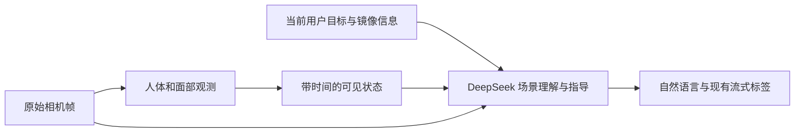

# 单人简单场景：姿势、表情、头朝向与连续指导

日期：2026-11-08，Asia/Shanghai。状态：已执行提示词实验；P2 保留为候选，未替换正式 prompt，未迁移客户端。

## 结论

在单人、无遮挡、简单背景下，DeepSeek Flash 可以提出随环境变化的姿势建议，也能识别张臂、叉腰、仰头、背影、明显微笑和张嘴。补充通用规则后，一轮到位核对全部正确，但重复测试和实际串联对话又错误肯定了转头方向。**提示词有改善，尚不足以作为持续指导中唯一的到位判据。**

这不支持“模型完全看不懂头朝向”的结论：同一图单独描述时能说对，在多目标指导里却错认已经完成。失败可能同时涉及视觉判断、目标与观察混淆、多轮注意分配，本实验不能隔离内部成因。

优先保留 LLM 的场景理解、姿势设计和自然交流；如继续开发连续核对，先补镜像元数据、当前目标记录以及头部/人体观测。没有依据现在就引入大型动作分类或通用物体识别系统。

## 范围与真实版本

- 代码基线：`3db31e1974e7271a0315decb7a57a5ba7e74a73f`；开始时工作区干净。仅新增本报告、更新索引与 CHANGELOG，实验文件位于忽略目录 `runtime_results/pose-prompt-20261108/`。
- 正式 prompt.py 前后 SHA-256：`fc730a01b4e2c273493beab7aa61e24affaeed22e640e36f266071433352c818`。
- 测试真人指导；没有合成立绘，没有测试双人、遮挡、真实摄像头或语音。合照中的真人与立绘协同效果未验证。
- 官方端点 `https://api.deepseek.com/chat/completions`，`model=deepseek-flash`、`thinking.type=enabled`、`reasoning_effort=low`、`stream=true`、`stream_options.include_usage=true`、`max_tokens=4096`；不设 temperature、top_p 或随机种子。
- 所有收到模型响应的请求均返回 `deepseek-flash`，fingerprint 为 `bc19ba97cbe016479903222bb1578db6`；别名不等于固定权重版本。
- PNG 以 base64、`detail=original` 输入；普通用户文本、图片与必要对话历史逐次提交。图片文件名和人工答案未传给模型。接口方式见官方[图像输入](https://api-docs.deepseek.com/guides/vision/)与[思考配置](https://api-docs.deepseek.com/guides/thinking_mode/)。
- 总共 **133 次请求尝试：131 次完整回答、1 次流未完成、1 次 HTTPS 连接错误**。42 次纯文本，91 次含图；故障也保留在分母。
- 密钥仅进入临时进程环境与认证头；请求正文、脚本和日志不保存密钥。思考过程只记录字符数。未启动已关闭的 MiniCPM 服务。
- P0/P1/P2 顺序测试，不是随机交错试验。重复次数少，结果是诊断证据，不是一般化准确率。

## 图片与判据

复用上一轮单人草地图：正面中性、正面微笑、背面自然垂臂；新生成并逐张目视检查 8 张图。它们均为同一合成人物，覆盖面有限。生成要求不是答案，判断以最终可见图像为准；例如远处人物实际缩小比例与生成要求不同，只测相对大小变化。

| 新图 | 可见内容 | SHA-256 前 12 位 |
|---|---|---|
| arms-neutral | 正面、双臂展开、头朝镜头、闭嘴中性 | 1960286ce17b |
| pose-complete | 正面、张臂、微笑、头朝画面左侧太阳 | 28200a3b3040 |
| back-arms | 背对镜头张臂，不可见表情 | 078ebd027e69 |
| head-right-surprise | 躯干正面、头朝画面右侧、张嘴，手臂下垂 | a70244c7e8ca |
| head-up-hands-hips | 双手叉腰、仰头、闭嘴中性 | 5684b95b2989 |
| far-front | 同一草地构图，人物显著变小、脚更接近地平线 | 5516b61bda28 |
| railing | 人在湖边木栏杆前，栏杆及下横木可见 | 8d71dd7c7c6f |
| phonebooth | 红电话亭在画面左，人站其右侧 | 14d4b7e1ee1a |

原图完整哈希见[上一轮记录](2026-11-08-deepseek-comparison.md)。新图完整哈希、生成提示词、原始输出路径和验图说明保存在本地 `audit.json`、`image-manifest.json`。媒体和完整请求不上传公开仓库。低太阳图不能确定日出或日落，模型称“夕阳”不单独计错。

每版基础集 36 题：核心观察 6、正面多目标核对 6、背影目标 2、改变目标 2、前后移动 7、已知左右 8、未知关系 2、场景建议 3。前后移动包括固定相机/焦距前提下的图像比较，只评价相对方向，不验证米数。

固定历史用例的助手指令由实验提供，用来控制目标一致。核心目标为“身体正面、张开双臂、微笑、头朝画面左侧太阳”。部分完成必须指出仍缺的部分；错误认可任一目标或给出反向纠正均不通过。完整姿势可以确认；额外提高审美要求另记，不与方向错误混为一类。观察题只评手臂、躯干、头的主要朝向和可见嘴部状态，不给附带细节背书。

## 提示词逐步差异

P0 是[上一轮方向候选 B](2026-11-08-deepseek-comparison.md)；它已在原 guidance 模板中加入以下内容，不是当前正式文件的原样：

> 给真人的左右建议以他自己的身体为参照。人正对镜头且画面未镜像时，画面左右与他自身左右相反；背对镜头时相同；镜像时再反转这个对应关系。先结合朝向与镜像把画面目标换算成他该走的方向；侧身或对应关系不明确时先确认。

### 第一处：核对当前事实与当前目标

修改前：只有“结合后续画面继续观察和调整”，未明确区分“要求做”和“已经做”。

P1 在邀请合照的原句之前增加：

```text
判断是否到位时，先看最新画面中用户实际做了什么，再与当前双方约定的目标对照；之前的指令不代表已经完成。身体朝向、头的朝向和视线分别观察，目标要求哪项就核对哪项。做到的部分可以肯定，没做到的给出自然、具体的调整；达到约定就确认，不额外提高要求。看不清的部分说明不确定，不靠目标补全画面。用户改变想法后按新目标继续，不再要求已取消的动作。
```

效果：错误转头图由 P0 的“头转对了”变为“头转反了”；完整姿势不再追加抬高手臂。但另一题让人从背面转回正面后，又错误要求朝“自己的左边”看太阳；单独观察题还把一次画面右转说成左转。

### 第二处：统一动作执行时的参照系

修改前：P1 有静态正/背面换算，但没有区分躯干与头，或转身前后的坐标。

P2 在 P0 方向段之后、P1 核对段之前增加：

```text
区分画面方位和人的身体方位：观察头朝哪边，要看脸和鼻子的朝向，不用人在画面中的位置代替头的朝向；转头本身不改变躯干的左右。先确定画面里的目标方向，再按执行该动作时的躯干朝向换算。若先让人转身，再给左右指示，就按转身后的朝向换算；也可以直接用清楚的环境参照物指引。前后移动优先说靠近镜头或远离镜头，避免正面和背面时产生歧义。
```

这是参照系原则，不规定姿势目录、每轮动作、固定角度或固定拍摄步骤。共用标签协议、模式模板与流式解析代码均未改。三版实际发送 system 的 SHA-256：

| 版本 | SHA-256 |
|---|---|
| P0 | `98faa24fb3887cddb04d0fe8695349480e74c2ad2d385da2a16ce279f7db895b` |
| P1 | `053090db78c30019eaf3ec3312cad5dff1b4979c913c13a3165f313e18f4ea34` |
| P2 | `39618c6ca2ee25720bfa52251ef2d795c6bc7630325b7d79097b8484fd0ab09a` |

本地 `p0.txt`、`p1.txt`、`p2.txt` 保存完整 system；新增规则单独保存在 `p1-rule.txt`、`p2-rule.txt`。P2 可供下一次实验加载，尚未采用到正式 prompt.py。

## 首轮相同 36 题对照

| 指标 | P0 | P1 | P2 |
|---|---:|---:|---:|
| 四项核心观察 | 6/6 | 5/6 | 6/6 |
| 正面多目标核对与纠错 | 5/6 | 5/6 | 6/6 |
| 背影目标：垂臂/张臂 | 2/2 | 2/2 | 2/2 |
| 取消旧目标及新目标后续 | 2/2 | 2/2 | 2/2 |
| 已知朝向、镜像时的身体左右 | 8/8 | 8/8 | 8/8 |
| 相对前后方向/画面大小变化 | 7/7 | 7/7 | 7/7 |
| 使用三个背景提出不同建议 | 3/3 | 3/3 | 3/3 |
| 完整回答 | 35/36 | 36/36 | 36/36 |
| 原生 speak / 整段仅合法标签和空白 | 35/36 | 35/36 | 35/36 |

这些是各项指定判据，不能相加当作“全部行为正确”。P0 对完成姿势仍建议再抬手；P1 一次说“我拍了”，实际没有拍摄。P2 栏杆建议包含踩下横木，图像只能证明横木存在，不能证明可承重。场景相关不等于所有动作可行性已验证。

未知关系不稳定，单独列出：P0 镜像未知给出两种正确条件，但侧身题流中断无答案；P1 镜像未知时只讲未镜像情况便要求行动，侧身题会询问肩膀与镜像；P2 镜像未知会请求举手确认，侧身题询问靠近镜头的肩膀，却没确认镜像便声称足以判断。没有完成校准后续，不能宣布未知镜像问题已解决。

## 重复、新目标与实际串联

P2 追加 10 个新题、4 个核心题重复、4 个新题重复，以及一段 6 轮实际对话。串联包含一次连接失败后显式重试，合计追加 25 次请求，P2 总计 61 次。

关键反例：

| 情况 | 实际结果 |
|---|---|
| 同一张“头朝画面右侧”的图，单独观察 | P2 首测与重复都正确说右侧 |
| 同图，目标是张臂、微笑、头看画面左侧太阳 | P2 首测指出转反；重复却说“头转向太阳这边了” |
| 同图，单独要求头朝自己的左/右 | 两题各测两次，4/4 能正确确认或纠正 |
| 同图进入真实串联历史 | 再次说“头转对了，看的就是太阳方向”，仍错 |
| 已张嘴的小 O 形表情 | 两次都要求嘴再张大，没明确认可当前小 O 目标；属于完成阈值/审美要求漂移，不等同于把张嘴识别成闭嘴 |
| 电话亭相对位置 | 一次说电话亭在画面右侧，实际在左；身体移动方向却正确。重复改为正确观察，但“走两步”没有尺度依据 |
| “站在电话亭右边、靠在它旁边” | 判对画面左右，追加贴肩要求；“靠在旁边”是否要求接触有语言歧义，本题不作为明确的视觉失败 |

核心题重复只通过 3/4；首轮 P2 的 6/6 不能当作稳定验收。新题中仰头叉腰、平静垂臂、闭嘴尚未完成张嘴目标、背对相机向后退靠近相机均判断正确。没有用这些较易题抵消关键方向失败。

实际串联使用前一轮真实 API 输出作为下一轮历史，而非固定助手指令：

1. 用户指定正面张臂、微笑、看太阳，模型给出对应建议。
2. 输入只张臂图，指出还缺转头和笑容；首次请求连接失败，第二次才收到此回答。
3. 输入转头反向且手臂垂下图，指出手臂与笑容未完成，**却错误认可头方向**。
4. 输入完成图，正确确认可以拍。
5. 用户改为双手叉腰、仰头、平静，模型接受新目标。
6. 输入新目标完成图，正确确认，不再要求旧目标。

6 个实际收到回复的轮次中，5 个满足指定内容判据；不能因整段能继续对话就记为连续核对通过。没有真实人按指令移动，没有验证实时调度、语音打断或立绘动作执行。

## 格式、延迟与故障

全体 133 次尝试有 129 次原生可解析 speak，且这 129 次整段只含合法标签和空白。另有 P1、P2 各一次裸文字，以及两次无回答故障。P0/P1/P2 分别有 2/1/1 次输出带换行；“仅合法标签”统计允许标签间空白，不等于全部严格单行。此次未运行普通文字适配、语音播放、模式切换或角色执行。

| 含图延迟（秒） | P0 首轮 n=22 | P1 首轮 n=22 | P2 首轮 n=22 | P2 全部成功含图 n=46 |
|---|---:|---:|---:|---:|
| 首段最终文字中位 | 3.953 | 4.663 | 3.977 | 5.290 |
| 首段最终文字 P90 | 5.657 | 8.234 | 7.062 | 12.625 |
| 首个完整 speak 中位 | 4.274 | 5.469* | 4.171 | 5.351 |
| 首个完整 speak P90 | 6.047 | 8.469* | 7.390 | 12.875 |

*P1 有一条裸文字，完整 speak 延迟只计算 21 个有效请求。P90 用 nearest-rank。统计包含连接、上传与推理，不是语音端到端延迟；串联、新题和顺序缓存影响条件，不能把后一列的变化全归因于 prompt 变长。P2 最慢成功含图请求整轮 16.375 秒，不适合据此承诺逐帧即时纠错。

两次故障不计入成功延迟，但不删除：

- P0 侧身题 HTTP 200 后只收到极少思考字符计数，没有最终文字、finish_reason 或完整流结束，3.047 秒，未重试。
- P2 串联第二轮在 HTTPS 阶段出现 SSL EOF，没有 HTTP 状态和模型输出；本机记录 elapsed=842.016 秒。原 transport 有 60 秒 socket timeout，120 秒总时限只在收到流数据后检查，**没有保证整个连接阶段的硬上限**。没有定位长耗时是否涉及本机暂停或网络栈，不能把它称为模型推理耗时。检查后仅重试一次，3.328 秒成功；后续 4 轮完成。恢复时复用已成功的首轮，没有重发整段。

已返回的 usage 合计 prompt_tokens=223000、completion_tokens=17569、total_tokens=240569；两次故障没有 usage，不能据此推断完整账单。请求正文哈希、system 哈希、流事件与凭据模式扫描已核对；没有修改或声称修复传输层。

## 若添加组件，最小方案

以下是根据本轮错误提出的工程建议，尚未安装或测量这些组件在本项目中的准确率与速度。

当前客户端是 Python/OpenCV，相关功能集中在 [realtime_av_test.py](../../realtime_av_test.py) 的 CameraSource、CanvasSource、MicrophoneSource、SpriteController、SpeechQueue 等类中，不是已经拆好的浏览器组件库；当前会话初始化关闭 TTS。

1. **先明确坐标和当前目标。** 保存实际模型图像是否镜像、帧时间和目标版本。当前代码未发现主动水平翻转，不代表摄像头驱动一定没有镜像。用户改主意时更新目标；旧帧、旧目标的迟到结果不能继续指挥用户。目标由对话决定，允许任意新姿势，不把用户锁进固定动作目录。
2. **头部和表情优先考虑 Face Landmarker。** 官方提供 478 个脸部关键点、52 个 blendshape 系数和可选面部变换矩阵，可用于估算头部朝向、嘴张开、嘴角变化。它们是几何/表面动作信号，不是“开心程度”的可靠读心标签。背面看不到脸时应标记不可观测；本轮不能保证它会改善小脸或侧脸，需要同组图和真人验证。[官方文档](https://developers.google.com/edge/mediapipe/solutions/vision/face_landmarker?tab=Python)
3. **张臂、叉腰与人物位置可用 Pose Landmarker。** 官方提供 33 个人体关键点、可见性和图像/身体相对三维坐标。用肩、肘、腕、髋等关系辅助判断目标；它不是自动理解所有创意动作的分类器。人物画面中心及占比可用于位置/相对远近，且相机、焦距和姿势条件要一致。其 world 坐标以髋部为原点，不能直接当作人距相机的绝对米数。[官方文档](https://developers.google.com/edge/mediapipe/solutions/vision/pose_landmarker?tab=Python)
4. **从原始相机图提取观测，再合成立绘。** 观测模块接在 CameraSource 后，避免把立绘当第二个人；带时间和置信度的简短观测摘要交给 LLM，仍让 LLM结合背景和意图组织自然语言。连续多帧一致性与“可用/不可用”状态由模块提供，具体阈值经实测决定。
5. **物体关系暂不引入大模型套件。** 本轮能识别栏杆/电话亭并提出互动方案，但位置语句仍会偶发自相矛盾。先做粗建议；若要求可靠走到某物体一侧，可增加目标区域/物体框与人体框的几何比较，或允许用户点选参照物。靠着/扶着是否实际接触，仅凭两框相邻还不能证明。

一个可逐步实现的接法：



下一次若验证候选，应保持 P2 文本不变，用真人录制的正/背面、左右转头及目标中途改变片段复核，先报告实际错误，再决定补哪一种观测。此次没有依据把候选直接写入仍使用 MiniCPM 路径的正式模板。
